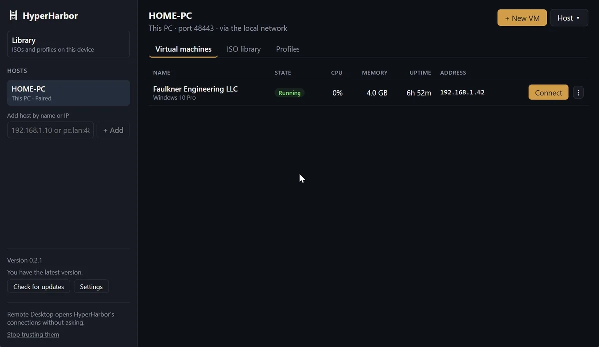
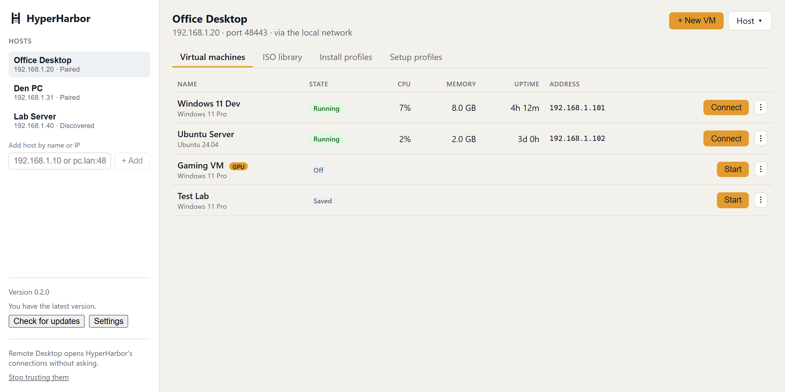
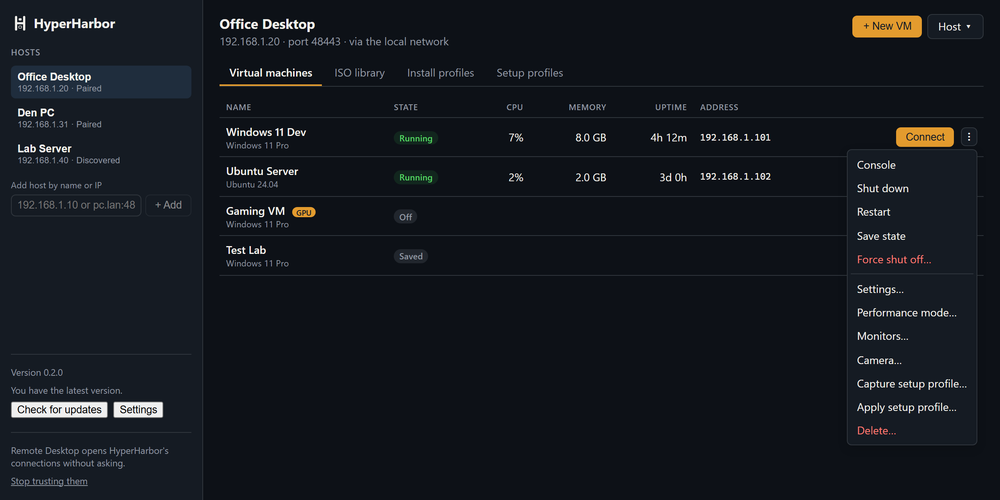

<picture>
  <source media="(prefers-color-scheme: dark)" srcset="hyperharbor-brand/png/lockup-horizontal-on-dark@2x.png">
  <source media="(prefers-color-scheme: light)" srcset="hyperharbor-brand/png/lockup-horizontal@2x.png">
  
</picture>

# HyperHarbor

[](https://github.com/faulkner-engineering/hyperharbor/actions/workflows/ci.yml)
[](https://github.com/faulkner-engineering/hyperharbor/releases)
[](LICENSE)


Manage Hyper-V virtual machines on a home PC and connect to them in one click from any device.







*The trailer and screenshots show demo data. The trailer is recorded with [tools/trailer](tools/trailer).*

## What it does

- **One-click Remote Desktop** to Windows and Linux virtual machines, with a per-user account whose password the host
  rotates on every connect.
- **Pairing with a PIN** shown on the host, then mutual TLS for everything after.
- **Wake-on-LAN** with readiness checks, so a sleeping host can be woken from the client.
- **VM lifecycle**: create from an ISO with an unattended install, change compute settings, delete, and the VM console.
- **Performance mode** (GPU partitioning and Remote Desktop tuning), camera sharing for concurrent sessions, backups with
  Kopia, moving and copying VMs between hosts, Tailscale, and self-updating host and client.

## Install

HyperHarbor has two parts: the **host**, on the PC that runs Hyper-V, and the **client**, on each PC you connect from.
Both are on the [Releases](https://github.com/faulkner-engineering/hyperharbor/releases) page. Read
[WARRANTY.md](WARRANTY.md) first: HyperHarbor administers Hyper-V and can change or delete virtual machines.

### Requirements

- **Host**: Windows 10 or 11 Pro, Enterprise, or Education with Hyper-V turned on (Settings > System > Optional
  features > More Windows features > Hyper-V), and an administrator account to install it.
- **Client**: Windows 10 or 11. Camera sharing for several sessions at once needs Windows 11.
- **Network**: the host's network must be set to **Private** in Windows, or its firewall blocks other devices.

### Host

1. Download `HyperHarbor-Host-<version>.exe` and double-click it. The builds are not code signed yet, so Windows
   SmartScreen may warn: choose **More info** > **Run anyway**.
2. Approve the administrator prompt. HyperHarbor installs a Windows service, allows TCP 48443
   through the firewall on Private networks, and adds **HyperHarbor Host** to the Start menu.
3. Open **HyperHarbor Host** and set an **admin passphrase**. Creating, deleting, and other risky actions from a client
   ask for it.

To remove the host, uninstall **HyperHarbor Host** from Settings > Apps > Installed apps (your settings are kept), or run
`HyperHarbor.Host.exe uninstall --remove-data` to remove them too.

### Client

1. Download `HyperHarbor_<version>_x64-setup.exe` and run it.
2. Open HyperHarbor. Hosts on your network appear under **Hosts**; add others by name or IP address.
3. Select the host, choose **Pair**, and type the PIN that the host shows.
4. Choose **Connect** on a running virtual machine. The first time, **Set up…** creates your account inside the VM.

Since the April 2026 Windows update, Remote Desktop asks what each connection may use. **Trust HyperHarbor connections**
at the bottom of the sidebar (one administrator approval) signs HyperHarbor's connections so it does not ask.

Both parts update themselves: the host from its window or a client's **Host** menu > **Updates**, the client from the
sidebar. The **beta** channel gets prereleases.

## Build from source

Requirements: .NET SDK 8.0, Rust (MSVC toolchain), and Node.js 20 or later.

```powershell
dotnet build HyperHarbor.sln
dotnet test HyperHarbor.sln

cd client
npm install
npm run tauri dev
```

`scripts\test-all.ps1` runs everything CI runs. `scripts\package.ps1` builds the host executable and the client
installer into `dist\`. [docs/development.md](docs/development.md) has every command, the live tests, and the release
steps. [docs/architecture.md](docs/architecture.md) explains how the parts fit together, and
[docs/platform-notes.md](docs/platform-notes.md) records Windows and Hyper-V behavior to know before changing an area.

| Path | Contents |
| --- | --- |
| `docs/api.yaml` | OpenAPI 3.1 contract between host and client |
| `host/src/Shared.Contracts` | DTOs mirroring the API contract |
| `host/src/Host.Core` | Hyper-V and host services |
| `host/src/Host.Service` | The host executable: API, Windows service, installer |
| `host/src/Host.Tray` | Tray and host window (pairing PIN, settings) |
| `host/tests/Host.Tests` | Host tests |
| `client/` | Tauri v2 client (Rust and Svelte/TypeScript) |

## Contributing

Bug reports, ideas, and pull requests are welcome. Everyone taking part follows the
[Code of Conduct](CODE_OF_CONDUCT.md).

- **Issues**: search the [issue tracker](https://github.com/faulkner-engineering/hyperharbor/issues) first, and include
  the host and client versions, your Windows edition and build, and what you expected. The host can save its logs from
  the client's **Host** menu > **Download host logs**. Report security problems privately as described in
  [SECURITY.md](SECURITY.md), not in an issue.
- **Pull requests**: keep each one to a single change, add or update tests, run `scripts\test-all.ps1`, and add a line
  to [CHANGELOG.md](CHANGELOG.md) under [Unreleased] for anything a user would notice. Changes to the API start in
  `docs/api.yaml`. For a larger change, open an issue first so the approach can be agreed.
- **Sign off your commits** under the [Developer Certificate of Origin](https://developercertificate.org/), which
  certifies that you wrote the change or otherwise have the right to submit it under the project's license. Add the
  line with `git commit -s`:

  ```text
  Signed-off-by: Your Name <you@example.com>
  ```

  Pull requests with unsigned commits cannot be merged.

Contributions are licensed under the Apache License 2.0, like the rest of the project.

## License and warranty

HyperHarbor is copyright 2026 Faulkner Engineering LLC and licensed under the [Apache License 2.0](LICENSE). It comes
with **no warranty**; see [WARRANTY.md](WARRANTY.md). Third-party components are listed in
[THIRD-PARTY-NOTICES.md](THIRD-PARTY-NOTICES.md).

## Brand

The logo, app and tray icons, colors, and usage rules are in [hyperharbor-brand/](hyperharbor-brand/README.md). The
Apache License does not grant rights to the HyperHarbor name or logo (section 6).
